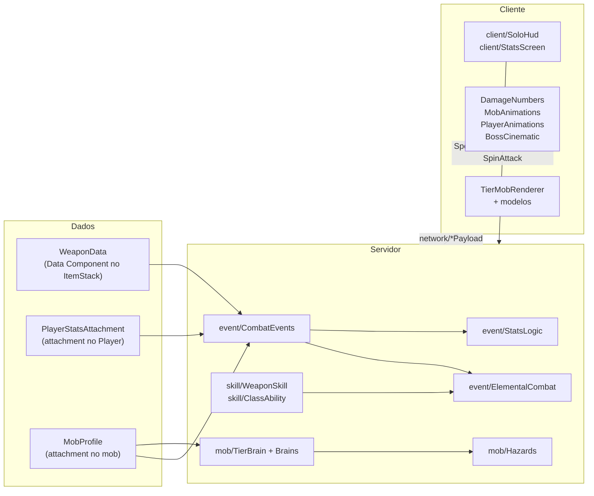
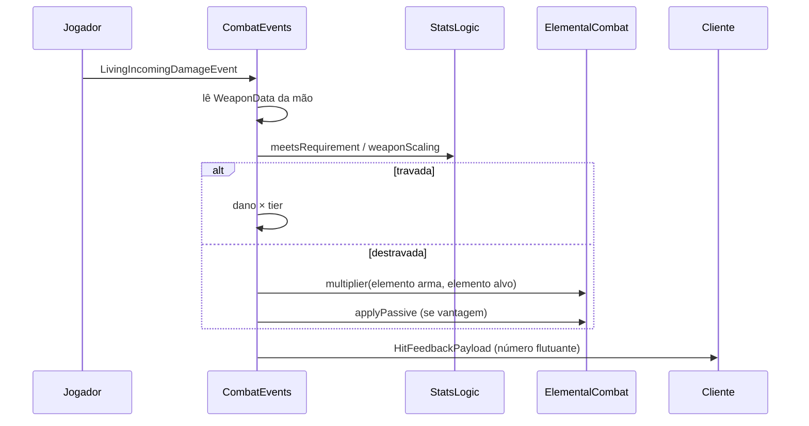

# 🏗️ Arquitetura

Mapa técnico do Solo Mod: o que é cada arquivo, como as peças conversam e onde mexer. As regras de jogo (números, ataques, comportamentos) estão em [GAMEPLAY.md](GAMEPLAY.md).

> Pacote base: `src/main/java/com/tarcitani/solomod/` — os caminhos abaixo são relativos a ele.

---

## Visão geral

### Os três dados centrais

| Dado | Tipo | Onde vive | Para quê |
|---|---|---|---|
| `WeaponData` | `record` imutável (Data Component) | `ItemStack` da arma | tier, classe, stat exigido, valor exigido, elemento, `skillId` |
| `PlayerStatsAttachment` | classe **mutável** (Data Attachment) | entidade `Player` | FOR/AGI/INT/VIT, XP Global, pontos, mana |
| `MobProfile` | `record` (Data Attachment) | qualquer `LivingEntity` | tier + elemento. **Ter perfil = ser "mob do mod"** |

### Dois barramentos de eventos

- **Mod bus**: registros (DeferredRegister), pacotes de rede, setup de cliente. Ligado em `SoloMod.java` e em `client/ClientSetup` (`@EventBusSubscriber(bus = MOD)`).
- **Game bus** (`NeoForge.EVENT_BUS`): dano, morte, tick, comandos. Servidor/comum: registrado em `SoloMod.java` (`CombatEvents`, `PlayerEvents`, `MobEvents`, `ClassAbility`, `ModTestCommand`). Cliente: `@EventBusSubscriber(value = Dist.CLIENT, bus = GAME)`.

---

## Mapa de arquivos

### Raiz

| Arquivo | O que é |
|---|---|
| `SoloMod.java` | Entrada do mod (`@Mod`). Chama os `register(modBus)` e registra as classes de evento no game bus. **Toda classe de evento nova do servidor precisa ser registrada aqui.** |

### `core/` — enums do domínio

| Arquivo | O que é |
|---|---|
| `ElementType.java` | `NONE, WATER, EARTH, FIRE, AIR`, com cor e ciclo de vantagem (`multiplier`). |
| `MobTier.java` | `NORMAL, OP, SUB_BOSS, BOSS`: multiplicador de dano, bônus de stat, potência elemental, nível de habilidade, requisito padrão, XP concedido e cor. |
| `StatType.java` | `FOR, AGI, INT, VIT`. |
| `WeaponClass.java` | 7 classes (`GREATSWORD, AXE, LONGSWORD, DAGGER, RAPIER, KUNAI, WAND`): peso (`HEAVY/MEDIUM/LIGHT/THROWN/CHANNEL`), stat padrão, dano e velocidade base, habilidade de tier padrão. |

### `component/` — dados no item

| Arquivo | O que é |
|---|---|
| `WeaponData.java` | Record gravado no ItemStack. Imutável: use `withRequirement(...)` / `withSkill(...)` e grave com `stack.set(...)`. Tem `CODEC` (save) e `STREAM_CODEC` (rede). **Campo novo = atualizar os dois codecs.** `defaultFor(...)` monta uma arma padrão. |
| `ModDataComponents.java` | Registro do componente `WEAPON_DATA`. |

### `attachment/` — dados em entidades

| Arquivo | O que é |
|---|---|
| `PlayerStatsAttachment.java` | Stats, XP, pontos e mana do jogador. Constantes `XP_PER_POINT=100`, `BASE_MANA=20`, `MANA_PER_INT=5`, `MAX_STAT=999`. Depois de alterar, **sempre** chame `StatsLogic.onStatsChanged(player)`. |
| `MobProfile.java` | Record `(tier, element)` que marca um mob como "do mod". |
| `ModAttachments.java` | Registro de `PLAYER_STATS` (salvo com a entidade e copiado na morte; o sync com o cliente é **manual** via `SyncStatsPayload`) e `MOB_PROFILE` (só existe em mobs marcados: teste com `hasData`). |

### `advancement/` — conquistas

| Arquivo | O que é |
|---|---|
| `ModAdvancements.java` | Identificadores de conquistas (`ResourceLocation`) e concessão via `awardBossDefeat(player, element)`. Concede os desafios individuais dos 5 Soberanos e pontua no desafio supremo (`defeat_all_sovereigns`). |

### `item/` — itens

| Arquivo | O que é |
|---|---|
| `ModularWeaponItem.java` | Item base de todas as armas. Tooltip (verde/vermelho conforme o requisito), clique direito (habilidade de classe ou de tier), `create(...)` para fabricar uma pilha configurada. |
| `ModItems.java` | Registra 1 item por `WeaponClass`, 1 ovo por criatura × elemento (20 ovos) e a aba criativa **Solo Mod** com todas as combinações. |

### `event/` — regras do servidor

| Arquivo | O que é |
|---|---|
| `CombatEvents.java` | **Coração do combate.** Em `LivingIncomingDamageEvent` (antes da armadura) aplica tier, escalonamento de stat e elemento ao golpe do jogador. Também redução de dano por VIT e envio dos números de dano. |
| `ElementalCombat.java` | Regras elementais compartilhadas: elemento de uma entidade, multiplicador, vantagem, passivas (fogo, lentidão etc.) e partículas. |
| `StatsLogic.java` | **Todo o balanceamento numérico** (constantes `FOR_FLAT_DAMAGE`, `AGI_*`, `VIT_*`, `WEAPON_STAT_SCALING`, `LOCKED_HEAVY_SPEED_PENALTY`) e a aplicação dos modificadores de atributo vanilla. `onStatsChanged` reaplica atributos e sincroniza. |
| `PlayerEvents.java` | Ciclo de vida: XP por abate de mob com perfil, regeneração de mana, reaplicar atributos em login, respawn e troca de dimensão. |

### `skill/` — habilidades

| Arquivo | O que é |
|---|---|
| `WeaponSkill.java` | Enum das habilidades de **tier** (`DASH_STRIKE, GROUND_SLAM, MANA_BOLT, ELEMENTAL_BURST`) com custo de mana, recarga e INT mínima. Cada constante implementa `perform(...)`. |
| `ClassAbility.java` | Habilidades de **classe** (sem mana): Estocada da rapieira, Arremesso da adaga, Salto do machado e Giro da espada longa. Tem eventos próprios (tick, queda, logout). |
| `SkillVfx.java` | Padrões de partículas do servidor (anel, linha) usados pelas habilidades. |
| `PlayerAnim.java` | Enum das animações do jogador (`SPIN, THRUST, LEAP_FLIP, SLAM`), tocadas por `client/PlayerAnimations`. |

### `entity/` — entidades próprias

| Arquivo | O que é |
|---|---|
| `TierMob.java` | Criatura própria de cada tier (`extends Monster`). Guarda o elemento em `SynchedEntityData` (o cliente escolhe modelo e textura com ele). Sem perfil ao nascer → recebe um elemento aleatório. O Soberano tem a morte de desintegração (`DISSOLVE_TICKS=100`). **O combate não fica aqui**, fica no `TierBrain`. |
| `ThrownDagger.java` | Adaga arremessada (`extends AbstractArrow`): voa girando, crava, volta como bumerangue quando o dono chama. |
| `ModEntities.java` | Registra `minion`, `elite`, `guardian`, `sovereign` e `thrown_dagger`, além dos atributos. `forTier(tier)` devolve o tipo da criatura. |

### `mob/` — IA e identidade dos mobs (servidor)

| Arquivo | O que é |
|---|---|
| `TierIdentity.java` | Aplica ou remove a **identidade** de um tier em qualquer `LivingEntity`: grava o `MobProfile`, escala (só mobs vanilla; as criaturas já têm o tamanho do modelo), atributos, título colorido, brilho (só BOSS) e instala o brain. `apply(entity, tier, element)` é o jeito oficial de transformar um mob; `clear` desfaz tudo. A tabela de números por tier está no Javadoc. |
| `TierBrain.java` | Classe abstrata (`Goal` de prioridade 0) que substitui a IA de combate vanilla enquanto há alvo. Sistema de **`Move`** (ataque com recarga, peso, `usable(dist)` e `tick(t)`), **Fúria** a 1/4 da vida (`addRageMove`), exaustão e invulnerabilidade em rugidos. `install(mob)` / `uninstall(mob)` / `of(entity)`. |
| `MinionBrain.java` | NORMAL: bando, grito de alerta, fuga, Bote. |
| `EliteBrain.java` | OP: guarda lateral, aparar e contra-atacar, Investida, Golpe Triplo. |
| `GuardianBrain.java` | SUB_BOSS: controle de distância, orbes, Repulsão, Salto, Translocar, Invocação + ataques de Fúria. |
| `SovereignBrain.java` | BOSS: 3 fases, leitura do estilo do jogador (perto/longe), barra de chefe, todos os ataques do chefe + Fúria. O maior arquivo de IA. |
| `Hazards.java` | Ataques que existem no mundo por alguns ticks sem ser entidade: orbes, áreas marcadas (meteoros), ondas de choque. Simulados no servidor e desenhados com partículas. Também tem helpers de dano em área (`enemiesIn`, `hit`, `push`) e sons. |
| `MobAnim.java` | Enum das animações de ação dos mobs (`WINDUP, LUNGE, DASH, COMBO, CAST, LEAP, SLAM, ROAR...`). O servidor diz **qual** animação e por quanto tempo; o cliente desenha. |
| `MobEvents.java` | Liga tudo ao ciclo de vida: reinstala o brain quando um mob salvo é carregado, tick, dano (Fúria, aparar, invulnerabilidade), morte, envia a identidade a quem começa a ver o mob, tick de `Hazards`. |

### `network/` — pacotes

Todos registrados em `ModNetwork.register` (protocolo `"1"`).

| Pacote | Direção | Para quê |
|---|---|---|
| `SyncStatsPayload` | S → C | cópia dos stats do jogador (HUD, tooltip) |
| `HitFeedbackPayload` | S → C | número de dano flutuante (`kind`: 0 normal, 1 vantagem, 2 desvantagem, 3 habilidade, 4 crítico) |
| `MobAnimPayload` | S → C | identidade do mob (tier, elemento, fase, fúria) + animação de ação |
| `PlayerAnimPayload` | S → C | animação de habilidade de um jogador |
| `CinematicPayload` | S → C | cinemática de morte do Soberano |
| `SpendPointsPayload` | C → S | botões +1/+5 da tela de Maestria (o servidor revalida) |
| `TestActionPayload` | C → S | botões da aba Teste (exige OP); também tem `spawnTierMob` e `mark` |
| `SpinAttackPayload` | C → S | clique de ataque da espada longa → giro 360° |
| `ModNetwork` | — | registro + helpers `syncStats`, `sendHit`, `sendMobAnim`, `sendPlayerAnim`, `sendCinematic` |

### `command/`

| Arquivo | O que é |
|---|---|
| `ModTestCommand.java` | Árvore do `/modtest` (OP nível 2). O Javadoc no topo lista todos os subcomandos. |

### `client/` — só cliente

| Arquivo | O que é |
|---|---|
| `ClientSetup.java` | Mod bus: tecla **K**, camada do HUD, cores dos itens (tinta por elemento), layers dos modelos e renderers. |
| `ClientGameEvents.java` | Game bus: abrir a tela com K, tick e render dos números de dano. |
| `ClientAccess.java` | Único ponto em que o código comum toca classes de cliente (`localPlayer()`). |
| `StatsScreen.java` | Tela da tecla K (abas Maestria e Teste). |
| `SoloHud.java` | HUD do canto superior esquerdo. |
| `DamageNumbers.java` | Números de dano flutuantes. |
| `MobAnimations.java` | Animações ociosas por tier + animações de ação recebidas do servidor. Guarda o estado (tier, elemento, fase, fúria) de cada mob no cliente. |
| `PlayerAnimations.java` | Animações das habilidades no jogador (giro, estocada, mortal) e troca do ataque da espada longa por `SpinAttackPayload`. |
| `BossCinematic.java` | Cinemática de morte do Soberano (faixas, câmera, letreiro). |

### `client/model/` e `client/render/`

| Arquivo | O que é |
|---|---|
| `TierMobModel.java` | Base dos modelos (`HierarchicalModel`): anima as partes com nomes conhecidos (`body`, `head`, `arm_r`...), as decorativas por prefixo e a desintegração. |
| `MinionModel` / `EliteModel` / `GuardianModel` / `SovereignModel` | Poses e animações de cada tier. Uma classe anima as 5 formas (base + 4 elementos) da criatura. |
| `MobMeshes.java` | ⚠️ **Gerado** por `tools/gen_mob_art.py`. Malhas (cubos + UV) das 20 formas. Não edite à mão. |
| `TierMobRenderer.java` | Troca de modelo e textura conforme o elemento. Camadas: base + brilho emissivo + aura de Fúria. |
| `ThrownDaggerRenderer.java` | Desenha a adaga voando, girando ou cravada. |

---

## Recursos (`src/main/resources/assets/solomod/`)

| Pasta | Conteúdo | Origem |
|---|---|---|
| `lang/` | `pt_br.json`, `en_us.json` | manual |
| `models/item/` | modelos das armas (2D, 3D, variantes elementais) e dos ovos | parte gerada por `tools/gen_weapon_models.py` |
| `textures/item/` | sprites das armas, `*_overlay` (parte tingida), variantes `_fire/_water/_earth/_air`, `weapon_parts*` (textura dos modelos 3D) | gerada por `tools/gen_weapon_models.py` / `gen_weapon_elements.py` |
| `textures/entity/` | `<mob>[_<elemento>].png` + `<mob>[_<elemento>]_glow.png` (emissiva) | gerada por `tools/gen_mob_art.py` |

`src/main/templates/META-INF/neoforge.mods.toml` é o template de metadados: o Gradle substitui `${...}` com os valores de `gradle.properties`.

## Scripts (`tools/`) — Python 3 + Pillow

| Script | Gera | Observação |
|---|---|---|
| `gen_mob_art.py` | `textures/entity/*.png` e `client/model/MobMeshes.java` | spec das 4 formas base; a mesma spec gera UV e textura, então os dois nunca saem de sincronia |
| `mob_variants.py` | — (importado por `gen_mob_art.py`) | as 16 formas elementais |
| `gen_weapon_models.py` | modelos 3D (rapieira/claymore), textura de peças, contorno fantasma da adaga, modelos dos ovos | ponto de entrada das armas |
| `gen_weapon_elements.py` | — (importado por `gen_weapon_models.py`) | versões elementais das armas 2D e 3D |

Rode da raiz: `python tools/gen_mob_art.py` e `python tools/gen_weapon_models.py`.

---

## Fluxos principais

### Golpe corpo a corpo do jogador

### Mob vira "mob do mod"

1. `/modtest mob`, o botão da aba Teste ou um `TierMob` nascendo chamam `TierIdentity.apply(entity, tier, element)`.
2. `apply` grava o `MobProfile`, aplica escala, atributos, título e brilho e chama `TierBrain.install(mob)`, que escolhe o brain pelo tier e adiciona os goals de alvo (todo mob do mod fica hostil ao jogador).
3. Quando um mob salvo é carregado do mundo, `MobEvents.onJoin` reinstala o brain, porque os goals não são salvos, só o perfil.
4. A cada ataque especial o brain envia `MobAnimPayload` → `client/MobAnimations` anima.
5. Na morte, `PlayerEvents.onKill` dá XP ao jogador conforme o tier.

### Stats

1. O cliente aperta +1 → `SpendPointsPayload` → o servidor valida e altera `PlayerStatsAttachment`.
2. `StatsLogic.onStatsChanged(player)` reaplica modificadores de atributo e chama `ModNetwork.syncStats`.
3. O cliente recebe `SyncStatsPayload` → HUD, tela e tooltips se atualizam.
