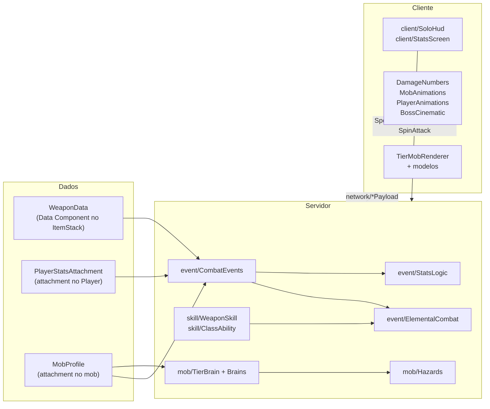
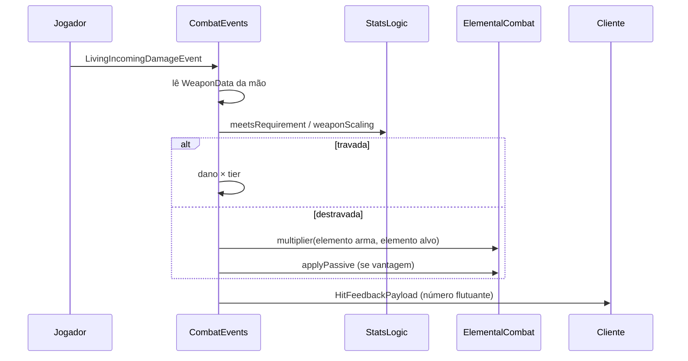

# 🏗️ Arquitetura

Mapa técnico do Solo Mod: o que é cada arquivo, como as peças conversam e onde mexer. As regras de jogo (números, ataques, comportamentos) estão em [GAMEPLAY.md](GAMEPLAY.md).

> Pacote base: `src/main/java/com/tarcitani/solomod/` — os caminhos abaixo são relativos a ele.

---

## Visão geral

### Os três dados centrais

| Dado | Tipo | Onde vive | Para quê |
|---|---|---|---|
| `WeaponData` | `record` imutável (Data Component) | `ItemStack` da arma | tier, classe, stat exigido, valor exigido, elemento, `skillId` |
| `PlayerStatsAttachment` | classe **mutável** (Data Attachment) | entidade `Player` | FOR/AGI/INT/VIT, XP Global, pontos, mana |
| `MobProfile` | `record` (Data Attachment) | qualquer `LivingEntity` | tier + elemento. **Ter perfil = ser "mob do mod"** |

### Dois barramentos de eventos

- **Mod bus**: registros (DeferredRegister), pacotes de rede, setup de cliente. Ligado em `SoloMod.java` e em `client/ClientSetup` (`@EventBusSubscriber(bus = MOD)`).
- **Game bus** (`NeoForge.EVENT_BUS`): dano, morte, tick, comandos. Servidor/comum: registrado em `SoloMod.java` (`CombatEvents`, `PlayerEvents`, `MobEvents`, `ClassAbility`, `ModTestCommand`). Cliente: `@EventBusSubscriber(value = Dist.CLIENT, bus = GAME)`.

---

## Mapa de arquivos

### Raiz

| Arquivo | O que é |
|---|---|
| `SoloMod.java` | Entrada do mod (`@Mod`). Chama os `register(modBus)` e registra as classes de evento no game bus. **Toda classe de evento nova do servidor precisa ser registrada aqui.** |

### `core/` — enums do domínio

| Arquivo | O que é |
|---|---|
| `ElementType.java` | `NONE, WATER, EARTH, FIRE, AIR`, com cor e ciclo de vantagem (`multiplier`). |
| `MobTier.java` | `NORMAL, OP, SUB_BOSS, BOSS`: multiplicador de dano, bônus de stat, potência elemental, nível de habilidade, requisito padrão, XP concedido e cor. |
| `StatType.java` | `FOR, AGI, INT, VIT`. |
| `WeaponClass.java` | 8 registros com ordinais preservados (`HAMMER` acrescentado ao fim). `AVAILABLE` define o catálogo atual: rapieira, espada longa, adaga e martelo. Cada classe define peso, stat, dano, velocidade e habilidade de tier padrão. Classes legadas continuam válidas em saves e comandos. |

### `component/` — dados no item

| Arquivo | O que é |
|---|---|
| `WeaponData.java` | Record gravado no ItemStack. Imutável: use `withRequirement(...)` / `withSkill(...)` e grave com `stack.set(...)`. Tem `CODEC` (save) e `STREAM_CODEC` (rede). **Campo novo = atualizar os dois codecs.** `defaultFor(...)` monta uma arma padrão. |
| `ModDataComponents.java` | Registro do componente `WEAPON_DATA`. |

### `attachment/` — dados em entidades

| Arquivo | O que é |
|---|---|
| `PlayerStatsAttachment.java` | Stats, XP, pontos, mana e IDs de habilidades aprendidas do jogador. Pontos de habilidade = nível menos custos dos nós aprendidos; independentes dos atributos. Campo NBT opcional `habilidades` e lista no buffer de sync. Constantes `XP_PER_POINT=100`, `BASE_MANA=20`, `MANA_PER_INT=5`, `MAX_STAT=999`. Depois de alterar, **sempre** chame `StatsLogic.onStatsChanged(player)`. |
| `ActiveEchoAttachment.java` | Record `(echo)` com o UUID do companheiro ativo da Fauna Pacífica (Ressonância de Alma Única). `NONE` quando não há companheiro. Salvo com o jogador. |
| `MobProfile.java` | Record `(tier, element)` que marca um mob como "do mod". |
| `ModAttachments.java` | Registro de `PLAYER_STATS` (salvo com a entidade e copiado na morte; o sync com o cliente é **manual** via `SyncStatsPayload`) e `MOB_PROFILE` (só existe em mobs marcados: teste com `hasData`). |

### `era/` — pós-jogo

| Arquivo | O que faz |
|---|---|
| `EraSevenState.java` | `SavedData` do Overworld com `isSovereignDefeated`. `setSovereignDefeated` salva e manda `EraStatePayload` a todos; `syncTo` no login (`PlayerEvents.onLogin`). Ligada por `SovereignBrain.onDeath` e por `/modtest era`. Lida pelo `EchoHunter` (reverência). |

### `advancement/` — conquistas

| Arquivo | O que é |
|---|---|
| `ModAdvancements.java` | Concessão das 27 conquistas em três abas (`echo_song/`, `serene_echoes/`, `seal_accomplices/`). Só a raiz da aba 1 usa `minecraft:tick`; o resto usa `minecraft:impossible` e é concedido por ganchos: `onTierKill` (`PlayerEvents.onKill`), `onPointsSpent` (`SpendPointsPayload`), `onRoyalFireballReflected` (`RoyalFireball`), `awardBossDefeat` (`MonarchBrain.onDeath`), `onSovereignSeen`/`awardSovereignDefeat` (`SovereignBrain`; a Sexta Voz vem 10 s depois pela agenda do `SovereignStageDialogueManager`), `onEchoBond`/`onEchoExhausted`/`onEchoAstral` (`PassiveEchoEntity`), `onFrameJump` (`PassiveEchoTriggers`) e `onSanctuaryBossDefeat` (`SanctuaryBoss.die`). Contadores (Monarcas, linhagens, 15 Ecos, 6 guardiões) são critérios da própria conquista. `ECHO_LINEAGE` diz a linhagem de cada forma da Fauna. |

### `item/` — itens

| Arquivo | O que é |
|---|---|
| `ModularWeaponItem.java` | Item base de todas as armas. Tooltip (verde/vermelho conforme o requisito), clique direito (técnica de classe) e Shift + direito (habilidade avançada aprendida), `create(...)` para fabricar uma pilha configurada. |
| `ModItems.java` | Registra 1 item por `WeaponClass`, 20 ovos elementais, o ovo do Soberano e os itens-ícones dos seis chefes. Aba **Solo Mod** para ovos; **Solo Mod: Armas** contém só os quatro itens de `WeaponClass.AVAILABLE`, neutros e de tier Normal. |
| `DissonanceShardItem.java`, `DissonanceShardEntity.java` | Fragmento de Dissonância (Era VII): item épico com tooltip ciano/vermelho que, no chão, vira uma `ItemEntity` indestrutível (`hasCustomEntity`/`createEntity`): recusa todo dano, não expira e volta à superfície se cair no vazio. Solto por `SovereignBrain.onDeath`. |

### `event/` — regras do servidor

| Arquivo | O que é |
|---|---|
| `CombatEvents.java` | **Coração do combate.** Em `LivingIncomingDamageEvent` (antes da armadura) aplica tier, escalonamento de stat e elemento ao golpe do jogador. Também redução de dano por VIT e envio dos números de dano. |
| `ElementalCombat.java` | Regras elementais compartilhadas: elemento de uma entidade, multiplicador, vantagem, passivas (fogo, lentidão etc.) e partículas. |
| `StatsLogic.java` | **Todo o balanceamento numérico** (constantes `FOR_FLAT_DAMAGE`, `AGI_*`, `VIT_*`, `WEAPON_STAT_SCALING`, `LOCKED_HEAVY_SPEED_PENALTY`) e a aplicação dos modificadores de atributo vanilla. `onStatsChanged` reaplica atributos e sincroniza. |
| `PlayerEvents.java` | Ciclo de vida: XP por abate de mob com perfil, regeneração de mana, reaplicar atributos em login, respawn e troca de dimensão. |

### `skill/` — habilidades

| Arquivo | O que é |
|---|---|
| `SkillTree.java` | Catálogo imutável por classe: IDs estáveis, pai, custos e mana; geometria radial exclusivamente no cliente. `consume` valida desbloqueio e cobra uma vez; `PlayerStatsAttachment.unlockTalent` valida pré-requisitos/pontos. Balanceamento em `StatsLogic.Talents`. |
| `WeaponSkill.java` | Enum das habilidades **avançadas da árvore** (`DASH_STRIKE, GROUND_SLAM, MANA_BOLT, ELEMENTAL_BURST`) com custo de mana, recarga e INT mínima. Cada constante implementa `perform(...)`. |
| `ClassAbility.java` | Habilidades de **classe** (árvore pessoal + mana): três técnicas da espada, três da rapieira, três do martelo e arremesso/retorno/teleporte da adaga. Seleção em EnumMap por jogador/classe; pico de queda limitado a 24 blocos. `TechniqueAction` controla tempos/acertos, recuo com colisão e onda com vítimas únicas e alcance apoiado, sem atravessar paredes. Valida item, dono, destino/recarga; cancela ações em troca de arma/dimensão, morte e logout. Constantes em `StatsLogic.WeaponAbilities`. |
| `WeaponTechnique.java` | Técnicas por classe, mantendo os três primeiros ordinais da espada; novos valores de rapieira e martelo no fim. Nomes, lista/padrão por classe, animação e consultas ao balanceamento central. Sem persistência no ItemStack. |
| `SkillVfx.java` | Padrões de partículas do servidor (anel, linha e arco horizontal relativo à direção frontal). |
| `PlayerAnim.java` | Enum de animações: preserva os ordinais anteriores; estocadas/recuo da rapieira e giro/ruptura do martelo foram acrescentados após `CROSS_CUT`. Tocado por `client/PlayerAnimations`. |
| `DodgeRoll.java` | Rolamento: valida os eixos do pedido, apoio físico, estado e recarga; aplica impulso com colisão e janela de esquiva de combate. Bloqueia armas/ataques durante a ação, limpa estado em morte/dimensão/logout/fim do servidor. Constantes em `StatsLogic.Dodge`. Registrado no game bus em `SoloMod`. |

### `entity/` — entidades próprias

| Arquivo | O que é |
|---|---|
| `TierMob.java` | Criatura própria de cada tier (`extends Monster`). Guarda o elemento em `SynchedEntityData` (o cliente escolhe modelo e textura com ele). Sem perfil ao nascer → recebe um elemento aleatório. O Monarca e o Soberano (tier BOSS) têm a morte de desintegração (`DISSOLVE_TICKS=100`). **O combate não fica aqui**, fica no `TierBrain`. |
| `Sovereign.java` | O Soberano, chefe final (`extends TierMob`, tier BOSS, sempre sem elemento). Atributos base próprios (`BASE_HEALTH`, `BASE_DAMAGE`), `RENDER_SCALE`, hitbox (`HITBOX_WIDTH`/`HITBOX_HEIGHT`/`EYE_HEIGHT`, menor que o modelo de propósito, explicado na Javadoc), sons e imunidade a fogo e a sufocamento (`isInvulnerableTo`). O combate fica em `mob/SovereignBrain`. |
| `SovereignTornado.java` | Tornado 3D do Soberano (`extends Entity`, sem colisão, não salvo): persegue um jogador a 0,13 bloco/tick, dura 11 s e lança quem encosta no pé (~11 blocos: o dano é da queda). Lógica só no servidor. Substituiu o antigo tornado de partículas. |
| `WaterOrb.java` | Esfera de água 3D do Soberano (`extends Entity`, não salva) em três modos: `ORBIT` (gira nele), `HOMING` (persegue o jogador e explode em respingo; um golpe direto a estoura) e `WAVE` (só visual: a crista do Maremoto). |
| `ThrownDagger.java` | Adaga arremessada (`extends AbstractArrow`): voa girando, crava, volta como bumerangue quando o dono chama. |
| `RoyalFireball.java` | Entidade `royal_fireball` (`Projectile`): bola de 2,4 blocos, lenta e rebatível. Colisão volumétrica e reflexão no servidor; devolvida causa dano mágico do jogador e tenta `TierBrain.stunFromFireball(100)` (bloqueado na Fúria). NBT guarda conjurador, reflexão, dano e idade. Modelo próprio em `RoyalFireballRenderer` (cubos no estilo do Minecraft, sem item vanilla). `launchGenki` é a genki-dama do Soberano: nasce acima das mãos, desce sobre o jogador e explode em área (`blastRadius`). Devolvida ao Soberano, só o atordoa (imune a fogo). As bolas do Soberano são removidas fora do estágio 2. |
| `passive/PassiveEchoEntity.java` | Base abstrata da Fauna Pacífica (`extends PathfinderMob`). Cargas (1–3 via `maxCharges`), exaustão (`cooldownTicks`), Forma Astral no `hurt` (dano ambiental letal → vida 1, invisível e sem IA por `DORMANT_TICKS`), bloqueio de todo dano de Guardião/Monarca/Soberano, vínculo por item (`isBondOffer`/`mobInteract`), seguimento do dono só quando é o companheiro ativo (`followOwner`) e `flyTowards`. Estado sincronizado por `EntityData`; cargas, exaustão, dormência e dono vão no NBT. |
| `passive/` — 15 formas | Uma classe por mob, todas `extends PassiveEchoEntity`: `SpectralScout`, `EchoRunicBat`, `RelicAutomaton` (Neutro); `IgneousSalamander`, `GoldenSilicaScarab`, `VolcanicAshColt` (Fogo); `LiquidManaAxolotl`, `LotusTurtleCrab`, `AbyssalTrenchRemora` (Água); `SylvanMiniTank`, `RunicBoulderGolem`, `AmberRootGazelle` (Terra); `CloudMantaRay`, `StormSentinelOwl`, `DimensionalRiftMoth` (Ar). Cada uma declara cargas, exaustão, item de vínculo, partícula da Forma Astral e a habilidade (`onAbility`). |
| `passive/PassiveEchoTriggers.java` | Gatilhos chamados pelos cérebros (`MinionBrain`, `EliteBrain`, `GuardianBrain`, `MonarchBrain`, `SovereignBrain`), pela esfera de água (`WaterOrb`), pela bola de fogo (`RoyalFireball`) e pelo `Hazards`. Só o companheiro **ativo** do jogador reage (`activeOf`). Guarda estado temporário no servidor (marcas, escudos, bolhas, gravidade, cúpulas), avançado por `tick()` (chamado em `MobEvents`) e zerado em `clear()`. `dampenPush` é aplicado por `Hazards.push` e aplica imunidade, bolha, cúpula e corte vertical. |
| `passive/PassiveEchoEvents.java` | Evento do game bus registrado em `SoloMod`: anula o dano de teleporte de Pérola do End quando a Mariposa ativa tem carga. |
| `sanctuary/SanctuaryMob.java` | Base dos mobs dos Santuários de Eco (`extends Monster`). Não usam `TierIdentity` nem cérebros: cada um decide os golpes na própria classe. Tem o golpe sincronizado (`attackId`, `attackTicks`, `swing`) que o modelo usa para animar, `addGroundGoals`/`addTargetGoals` e `isIllusion`. `Hazards.isEnemy` trata todos como aliados entre si. |
| `sanctuary/SanctuaryBoss.java` | Base dos 6 chefes: barra de vida (`ServerBossEvent`), 3 fases (`phase()`), ciclo `chooseAttack` → `tickAttack` (true enquanto o golpe dura), `pick`, `summon` e `countNearby`. |
| `sanctuary/Bruiser.java`, `Slammer.java`, `HoverShooter.java`, `HoverNearTargetGoal.java` | Bases dos capangas: corpo a corpo com efeito no golpe (`onHit`); martelada telegrafada com onda de choque do elemento; voador que paira e dispara (`shoot`, orbe por padrão); e a meta de voo usada pelos voadores e pelos chefes que voam. |
| `sanctuary/` — chefes | `Cinzagrim` (Forja), `Archivist` (Biblioteca; as cópias são a mesma entidade com `ILLUSION`, sem saque nem barra), `Weeper` (Marés), `RootMother` (Jardim; corta o dano no golpe Casca), `Herald` (Torre; voa), `EchoHunter` (Catacumba; também mira `PassiveEchoEntity`). Saque em `loot_table/entities/<id>`. |
| `sanctuary/` — capangas | Forja: `LivingSlag`, `WitheredSmith`, `ForgeSpark`. Biblioteca: `InkSentinel`, `SpectralScribe`, `FlyingTome`. Marés: `ChoirDrowned`, `CoralCrab`, `CoralJelly`. Jardim: `ThornSprout`, `MossGolem`, `AmberWasp`. Torre: `GrayHarpy`, `GaleTotem`, `BreezeElemental`. Catacumba: `WhisperingBones`, `CreepingShadow`, `WailingShade`. |
| `worldgen/ModStructures.java` | Registra um `StructureType` (`solomod:sanctuary`) e um `StructurePieceType` para os 6 santuários. |
| `worldgen/SanctuaryKind.java` | Enum dos 6 santuários: nome serializado (campo `"sanctuary"` do JSON e NBT da peça, **não renomeie**), paleta de blocos (`Palette`), guarnição (chefe, capangas, voador) e se é enterrado. |
| `worldgen/SanctuaryStructure.java`, `SanctuaryPiece.java` | Estrutura (mede a superfície; enterrada fica 22 abaixo, com a caixa até a superfície) e peça única que constrói a planta redonda em código, o poço da Catacumba, o baú (`loot_table/chests/<nome>`) e a guarnição. Dados em `data/solomod/worldgen/` (structure, structure_set) e tags `has_structure/<nome>`. |
| `worldgen/StructureAmbientHandler.java` | A falha da realidade viva de cada santuário: a cada 10 ticks acha o santuário em que o jogador está (`getStructureWithPieceAt`) e aplica o efeito (partículas, geada sem dano na Forja, escuridão na Catacumba, silêncio da Torre por `AmbientSilencePayload`). A parte física (correntes, bigornas em `block_display`, estantes, lágrimas, árvores-nervo, torre fatiada, costelas) é `SanctuaryPiece.buildRealityFault`. |
| `worldgen/ColossalKind.java`, `ColossalShapes.java` | Os 5 tronos e o Anfiteatro: tamanho da caixa, como achar a base (superfície, fundo do mar, vazio) e o Monarca de cada trono; as formas bloco a bloco (funções puras de posição relativa: cones, toros, cápsulas, espirais, com ruído de hash), os pontos do Monarca e das esferas de âmbar. Meia-largura abaixo de 128 (limite de ligação de estruturas do Minecraft). |
| `worldgen/ColossalStructure.java`, `ColossalPiece.java` | Estrutura (`solomod:colossal`, campo `"colossus"` no JSON) e peça que percorre só a interseção da caixa com o pedaço de mundo gerado, escreve as formas e cria o Monarca do trono (perfil aplicado antes do `finalizeSpawn`) e as criaturas congeladas. O `StructureAmbientHandler` também cuida dos efeitos dos colossos e chama o Soberano no Anfiteatro (com `Sovereign.setHome`, que o devolve à arena se cair no vazio). |
| `ModEntities.java` | Registra `minion`, `elite`, `guardian`, `monarch`, `sovereign`, `thrown_dagger`, `royal_fireball` e as 15 formas da Fauna Pacífica, além dos atributos. `forTier(tier)` devolve o tipo da criatura do tier (BOSS = Monarca). |

### `mob/` — IA e identidade dos mobs (servidor)

| Arquivo | O que é |
|---|---|
| `TierIdentity.java` | Aplica ou remove a **identidade** de um tier em qualquer `LivingEntity`: grava o `MobProfile`, escala (só mobs vanilla; as criaturas já têm o tamanho do modelo), atributos, título colorido, sem contorno luminoso de chefes e instala o brain. `apply(entity, tier, element)` é o jeito oficial de transformar um mob; `clear` desfaz tudo. A tabela de números por tier está no Javadoc. |
| `TierBrain.java` | Classe abstrata (`Goal` de prioridade 0) que substitui a IA de combate vanilla enquanto há alvo. Sistema de **`Move`** (ataque com recarga, peso, `usable(dist)` e `tick(t)`), **Fúria** a 1/4 da vida (`addRageMove`), exaustão e invulnerabilidade em rugidos. Ganchos para chefes especiais: `rageThreshold`, `beginRage`, `endlessRage`, `interrupt`. `install(mob)` escolhe o brain pelo tier (BOSS: `SovereignBrain` se for a entidade `Sovereign`, senão `MonarchBrain`) / `uninstall(mob)` / `of(entity)`. |
| `MinionBrain.java` | NORMAL: bando, grito de alerta, fuga, Bote. |
| `EliteBrain.java` | OP: guarda lateral, aparar e contra-atacar, Investida, Golpe Triplo. |
| `GuardianBrain.java` | SUB_BOSS: controle de distância, orbes, Repulsão, Salto, Translocar, Invocação + ataques de Fúria. |
| `MonarchBrain.java` | BOSS: 3 fases, leitura do estilo do jogador (perto/longe), barra de chefe, todos os ataques do chefe + Fúria. Guarda quem causou dano e, na morte, concede as conquistas a esses jogadores. O maior arquivo de IA. |
| `SovereignBrain.java` | O Soberano: 6 estágios de vida, agonia invulnerável com close (`CinematicPayload` `CLOSE_UP`) a cada estágio, um ataque novo por estágio (`StageMove`: Punho, Genki-dama, Maremoto, Raízes, Pisão, Tornados), Fúria sem fim no 6º com o Raio do Peito (`ChestBeam`, prioridade, termina em `kneel`) e os poderes dos Monarcas um por vez, voos curtos (`Hop`: recuo antes do raio, avanço contra kite/preso), **escolha por prioridade** (`Move.urgency`: pisão/punho quando colado, voo, raio) e leitura de como o jogador luta (pressão melee/ranged, combo pós-pisão), trava de vida por estágio em `onHurt`, **estágio restaurado pela vida** ao reinstalar o cérebro (`stageFromHealth`), padrões de vários jogadores (foco rotativo, grupo junto/espalhado, `damageTakenMultiplier` por jogador), movimento direto sem pathfinding (`chase`), risada com cinemática, cinemática final + créditos e conquista na morte. `skipToStage` para o `/modtest`. |
| `SovereignStageDialogueManager.java` | Roteiro do Soberano: intro, falas de início e transição de cada estágio (transição no letreiro do close, início na barra de ação), fala do Raio do Peito e da exaustão, risada aleatória, morte por glitch (fala 1 no letreiro, troca para a fala 2 sem reiniciar a cena, aviso da Era VII a todo o servidor) e partículas ciano/vermelho/roxo. Tarefas atrasadas no servidor, avançadas por `tick()` em `MobEvents`. Textos em `dialogue.solomod.sovereign.*`. O cliente (`BossCinematic`) quebra falas longas em linhas e troca o texto de uma cena já aberta quando chega um pacote da mesma entidade e tipo. |
| `Hazards.java` | Ataques que existem no mundo por alguns ticks sem ser entidade: orbes, áreas marcadas (meteoros), ondas de choque, tornados e `QuakeBlocks` (terremoto: blocos do chão viram `FallingBlockEntity` e voltam). Simulados no servidor e desenhados com partículas. Também tem helpers de dano em área (`enemiesIn`, `hit`, `push`) e sons. |
| `MobAnim.java` | Enum das animações de ação dos mobs (`WINDUP, LUNGE, DASH, COMBO, CAST, LEAP, SLAM, ROAR..., AGONY`). O servidor diz **qual** animação e por quanto tempo; o cliente desenha. |
| `MobEvents.java` | Liga tudo ao ciclo de vida: reinstala o brain quando um mob salvo é carregado, tick, dano (Fúria, aparar, invulnerabilidade), morte, envia a identidade a quem começa a ver o mob, tick de `Hazards`. |

### `network/` — pacotes

Todos registrados em `ModNetwork.register` (protocolo `"5"`; cliente e servidor precisam desta versão dos pacotes).

| Pacote | Direção | Para quê |
|---|---|---|
| `SyncStatsPayload` | S → C | cópia dos stats do jogador (HUD, tooltip) |
| `HitFeedbackPayload` | S → C | número de dano flutuante (`kind`: 0 normal, 1 vantagem, 2 desvantagem, 3 habilidade, 4 crítico) |
| `MobAnimPayload` | S → C | identidade do mob (tier, elemento, fase, fúria) + animação de ação |
| `PlayerAnimPayload` | S → C | animação de habilidade de um jogador |
| `CinematicPayload` | S → C | cinemática de chefe: `kind` (`DEFEAT` morte do Monarca, `CLOSE_UP` agonia do Soberano, `FINALE` morte do Soberano + créditos, `LAUGH` risada dele ao matar um jogador), cabeçalho e título |
| `UnlockTalentPayload` | C → S | ID do nó solicitado; servidor valida existência, duplicata, pontos e dependência antes de sincronizar stats |
| `RollCooldownPayload` | S → C | ticks restantes ao aceitar/recusar por recarga o rolamento; zero na morte/troca de dimensão |
| `SpendPointsPayload` | C → S | botões +1/+5 da tela de Maestria (o servidor revalida) |
| `TestActionPayload` | C → S | botões da aba Teste (exige OP); também tem `spawnTierMob` e `mark` |
| `ShakePayload` | S → C | tremor de câmera (`client/ScreenShake`): força inicial e duração; `ModNetwork.sendShake` envia a quem está perto, mais fraco com a distância |
| `SpinAttackPayload` | C → S | compatibilidade: pedido legado da espada longa → meia-lua validada com a mesma recarga do botão direito; cliente atual não envia |
| `DodgeRollPayload` | C → S | pedido de rolamento: só eixos -1/0/1; servidor decide velocidade, direção mundial, condições e recarga |
| `RollAnimationPayload` | S → C | jogador e direção real do rolamento, para animar cambalhotas laterais e para trás |
| `CrescentSlashPayload` | S → C | jogador, direção travada, elemento e técnica do rastro 3D; não aplica dano no cliente |
| `CycleTechniquePayload` | C → S | pedido sem argumentos; servidor infere a arma na mão, valida classe/estado e só então alterna técnica |
| `TechniqueSelectionPayload` | S → C | confirmação por classe (a classe vem da técnica); HUD/painel/tooltip só atualizam após o servidor |
| `WeaponMotionPayload` | S → C | tipo, entidade, origem/destino e intensidade de efeitos 3D: velocidade, adaga elétrica, teleporte e impacto |
| `ModNetwork` | — | registro + helpers `syncStats`, `sendHit`, `sendMobAnim`, `sendPlayerAnim`, `sendCinematic`, `sendWeaponMotion` (envia também a espectadores perto da chegada do teleporte) |

### `command/`

| Arquivo | O que é |
|---|---|
| `ModTestCommand.java` | Árvore do `/modtest` (OP nível 2). O Javadoc no topo lista todos os subcomandos. |

### `client/` — só cliente

| Arquivo | O que é |
|---|---|
| `ClientSetup.java` | Mod bus: tecla **K**, camada do HUD, cores dos itens (tinta por elemento), layers dos modelos e renderers. |
| `ClientGameEvents.java` | Game bus: tela K, tick/render do dano e cancelamento de `RenderGuiLayerEvent.Pre` só para `VanillaGuiLayers.PLAYER_HEALTH`, condicionado à visibilidade da HUD. Logout reinicia interpolação. |
| `ClientAccess.java` | Único ponto em que o código comum toca classes de cliente (`localPlayer()`). |
| `ClientEraState.java`, `SkyScarRenderer.java` | Cópia no cliente da flag da Era VII (`EraStatePayload`) e a Cicatriz no Céu: fenda com aberração cromática desenhada em `AFTER_SKY` no zênite, entre os ticks 17500 e 18500 do dia, mais fagulhas de estática no `ClientTickEvent`. |
| `AmbientSilence.java` | Silêncio do sino da Torre: enquanto `AmbientSilencePayload` estiver valendo, cancela no `PlaySoundEvent` todo som de ambiente, clima, música e disco (e para os que já tocavam). |
| `ArenaSkyRenderer.java` | Céu do Anfiteatro (`ArenaSkyPayload`): cinco retalhos coloridos com bordas de falha ciano/vermelho em `AFTER_SKY`. |
| `SkillTreeLayout.java` | Coordenadas radiais em quatro setores de 90°, catálogo `WeaponClass.AVAILABLE` e seus 19 nós visíveis. Classes legadas ficam fora do mapa; dados persistidos são preservados. Nenhum estado de gameplay ou filtro. |
| `SkillTreeScreen.java` | Mapa radial único em K → Habilidades: skin no centro, quatro armas normais do catálogo em círculo, raízes com molduras vanilla, arraste nos dois eixos e zoom ancorado no cursor. Sem filtros. Tooltips e botão Aprender. |
| `StatsScreen.java` | Tela K com cartões de atributos em duas colunas, resumo de mana/XP/arma/técnica e abas Maestria/Teste. Painel e cartões antes dos widgets, preservando clique/foco/narração. |
| `RpgUi.java`, `RpgButton.java` | Paleta de aço escuro e ouro, painéis com cantos em pixels, cartões, barras segmentadas com reflexo, texto dimensionado e botões com navegação/narração vanilla. |
| `SoloHud.java`, `HudArt.java` | HUD compacta com brasão facetado, coroa, runas orbitais, barras biseladas e faixa de arma/técnica/recarga. Vida mostra absorção/veneno/wither/dano, mana/XP têm suavização/reflexo. Aproximadamente 164×62 com arma; carga acrescenta 12 px. Detalhes ficam no painel/tooltip. |
| `WeaponControls.java` | R configurável nas três classes; EnumMap por classe guarda apenas seleção confirmada. Ignora menus e uso contínuo. Mantém o id da tecla `cycle_sword` para preservar configurações já salvas. |
| `DamageNumbers.java` | Números de dano flutuantes. |
| `MobAnimations.java` | Animações ociosas por tier + animações de ação recebidas do servidor. Guarda o estado (tier, elemento, fase, fúria) de cada mob no cliente. |
| `PlayerAnimations.java` | Poses da arma em primeira pessoa (inclui canhotos), braços/corpo em terceira pessoa e câmera: três técnicas da espada, carga/estocada, salto/mergulho/impacto e adaga. O ataque esquerdo continua vanilla; carga visual segue o estado de uso nativo da rapieira, sem pacote cliente→servidor adicional. |
| `DodgeInput.java` | Duplo pressionamento do mesmo Ctrl em até 280 ms, sem contar repetição da tecla, fora de menus. Envia eixos de WASD; não movimenta nem dá invulnerabilidade no cliente. |
| `WeaponEffects.java` | Render após partículas: Meia-Lua horizontal, Ascendente vertical e dois planos diagonais no Cruzado; lâmina volumétrica em segmentos retos, halo elemental e fio branco. Respeita profundidade e se dissipa na recuperação; dados de `CrescentSlashPayload`. |
| `MotionEffects.java`, `FxGeometry.java` | Barras/cubos procedurais com volume: velocidade, agulhas da rajada, recuo, giro dourado, fissura com fragmentos, adaga elétrica/teleporte e impacto. A onda usa origem/alcance medidos no servidor no momento do golpe; os demais seguem entidades reais. Limitam quantidade/duração, cancelam em troca de arma e limpam em troca de mundo/logout. Sem dano no cliente. |
| `client/mixin/HumanoidModelMixin.java` | Hook somente cliente ao fim de `HumanoidModel.setupAnim`: aplica braços/mão de apoio da meia-lua e membros recolhidos do rolamento. `PlayerModel` copia as poses para mangas depois. Declarado em `solomod.client.mixins.json`, seção `client`, e em `[[mixins]]` dos metadados; servidor dedicado não carrega classes de modelo. |
| `BossCinematic.java` | Cinemáticas de chefe (faixas, câmera, zoom, letreiro). Close forte no rosto no `CLOSE_UP`; no fim do `FINALE` abre os créditos. |
| `CreditsScreen.java` | Créditos do fim da versão de testes: texto rolando (`credits.solomod.*`), música de créditos, ESPAÇO acelera, ESC fecha. |
| `ScreenShake.java` | Tremor de câmera (guinada, inclinação e rolagem) disparado por `ShakePayload`: terremoto do pisão, pouso dos voos, soco do Soberano. Não muda a mira. |

### `client/model/` e `client/render/`

| Arquivo | O que é |
|---|---|
| `TierMobModel.java` | Base dos modelos (`HierarchicalModel`): anima as partes com nomes conhecidos (`body`, `head`, `arm_r`...), as decorativas por prefixo e a desintegração. |
| `MinionModel` / `EliteModel` / `GuardianModel` / `MonarchModel` | Poses e animações de cada tier. Uma classe anima as 5 formas (base + 4 elementos) da criatura. |
| `SovereignModel.java` | O Soberano: herda do `MonarchModel` (mesmos nomes de partes) e acrescenta as poses de agonia, genki-dama (braços unidos no alto), pisão, flutuar com braços abertos (tornados) e raio do peito, além do tremor da coroa. |
| `MobMeshes.java` | ⚠️ **Gerado** por `tools/gen_mob_art.py`. Malhas (cubos + UV) das 20 formas e do Soberano. Não edite à mão. |
| `SovereignTornadoRenderer` / `WaterOrbRenderer` / `EffectMesh` | Renderers procedurais dos efeitos 3D do Soberano **no estilo do Minecraft (só cubos e barras retas, nada redondo)**: o tornado é uma pilha de 14 anéis quadrados girando em degraus; a esfera de água é um cubo dentro de cubo dentro de cubo com cubinhos em órbita. `EffectMesh` tem `cube`, `box` e `squareRing`. Texturas 16x16 de `tools/gen_sovereign_effects.py`. |
| `TierMobRenderer.java` | Troca de modelo e textura conforme o elemento. Camadas: base + brilho emissivo + aura de Fúria. `single(...)` é para criatura sem variantes (o Soberano): malha única, escala maior e **sem a camada de brilho** (só a aura de Fúria). |
| `ThrownDaggerRenderer.java` | Desenha a adaga voando, girando ou cravada. |
| `RoyalFireballRenderer.java` | Malha procedural exclusiva: núcleo facetado, crosta vazada, dois anéis de plasma e seis fragmentos orbitais, com luz máxima e texturas próprias. |

---

## Recursos (`src/main/resources/assets/solomod/`)

| Pasta | Conteúdo | Origem |
|---|---|---|
| `lang/` | `pt_br.json`, `en_us.json` | manual |
| `models/item/` | modelos normais das armas (2D, 3D) e dos ovos | parte gerada por `tools/gen_weapon_models.py` |
| `textures/item/` | sprites normais das armas, `*_overlay` (parte tingida), `weapon_parts*` (textura dos modelos 3D) | gerada por `tools/gen_weapon_models.py` / `gen_weapon_elements.py` |
| `textures/entity/` | `<mob>[_<elemento>].png` + `<mob>[_<elemento>]_glow.png` (emissiva) | gerada por `tools/gen_mob_art.py` |

Dados do servidor ficam em `src/main/resources/data/solomod/`:

| Pasta | Conteúdo | Origem |
|---|---|---|
| `advancement/` | 27 JSON em três pastas de aba (`echo_song/`, `serene_echoes/`, `seal_accomplices/`). Títulos e descrições em `advancements.solomod.<id>.*` no lang. | `gen_advancements.py` |

`src/main/templates/META-INF/neoforge.mods.toml` é o template de metadados: o Gradle substitui `${...}` com os valores de `gradle.properties`.

## Scripts (`tools/`) — Python 3 + Pillow

| Script | Gera | Observação |
|---|---|---|
| `gen_mob_art.py` | `textures/entity/*.png` e `client/model/MobMeshes.java` | spec das 4 formas base; a mesma spec gera UV e textura, então os dois nunca saem de sincronia |
| `mob_variants.py` | — (importado por `gen_mob_art.py`) | as 16 formas elementais e o Soberano (`sovereign()`) |
| `gen_boss_icons.py` | `textures/item/monarch_*_head.png`, `sovereign_head.png`, `unknown_boss.png` e respectivos modelos de item | Rostos dos seis chefes em pixel art 16×16 RGBA; reutiliza a matriz do Soberano de `gen_sovereign_icons.py`. `gen_boss_icons.ps1` redireciona para este gerador. |
| `gen_royal_fireball.ps1` | `textures/entity/royal_fireball.png` e `royal_fireball_core.png` | Texturas originais 16×16 de pixels grandes (crosta de basalto com lava e núcleo de magma), determinísticas, para a malha de cubos; não reutilizam arte do Ghast. |
| `gen_weapon_models.py` | modelos 3D normais (rapieira, espada longa, adaga, martelo), textura pixel art de peças, fantasma 3D da adaga, ícones GUI separados e modelos dos ovos | ponto de entrada das armas; mantém os modelos das classes legadas fora da GUI |
| `weapon_icons.py` | 9 sprites GUI 32×32 (oito classes normais + fantasma da adaga) | aço facetado, ouro, couro, gemas e ornamentos; apenas pixel art sem suavização |
| `gen_weapon_elements.py` | utilitário legado sem chamada no pipeline atual | variantes elementais de armas desativadas |
| `gen_sovereign_effects.py` | `textures/entity/sovereign_tornado.png`, `water_orb.png`, `water_orb_core.png` | texturas 16x16 de pixels grandes dos efeitos 3D do Soberano (a mesma saída sempre: ruído por hash de x, y) |
| `gen_passive_echo.py` | `textures/entity/passive/*.png` e `*_glow.png` (15 pares 64×64 da Fauna Pacífica; o brilho é tons de cinza, tingido pela cor do elemento no render) | Mesma função de hash determinística dos outros geradores; cada forma tem uma função de pixel. As malhas são feitas em código (`client/model/PassiveEchoModels.java`). O brilho é derivado da malha: o script lê os cubos, calcula a área de UV de cada um e acende só os cubos listados em `GLOW_CUBES`. `--repack` reempacota os `texOffs` sem sobreposição; rode-o depois de mudar a malha. |
| `gen_sanctuary.py` | `textures/entity/sanctuary/*.png` e `*_glow.png` (24 criaturas) e os modelos de item dos ovos dos Santuários de Eco | O shelf packing de `SanctuaryModels.Atlas` é repetido aqui lendo, em ordem, `a.add(...)`, `a.glow(...)` e `legs(...)` do Java; só os cubos de `a.glow` acendem. A cor base vem de `PALETTES`. Mexeu na malha: rode o script. Nada de laços em torno dessas chamadas. |
| `gen_dissonance_shard.py` | `textures/item/dissonance_shard.png` e o modelo do item | Pixel art 16×16: caco escuro com núcleo branco e canais ciano/vermelho desalinhados. |
| `gen_advancements.py` | `data/solomod/advancement/<aba>/*.json` (27 conquistas) | Uma tabela por conquista: aba, pai, ícone, moldura, oculta, critérios e XP. Os nomes dos critérios precisam bater com `ModAdvancements`. Apaga e recria a pasta. |
| `gen_sovereign_icons.py` | `textures/item/sovereign_head.png` e `unknown_boss.png` | ícones 16x16 das conquistas do Soberano (a cabeça e o "???"); o desenho são as matrizes no próprio script |

Rode da raiz: `python tools/gen_mob_art.py` e `python tools/gen_weapon_models.py`.

Ícones dos chefes: `python tools/gen_boss_icons.py`. `ModItems.MONARCH_*_HEAD` registra os itens visuais usados como ícones das conquistas dos Monarcas (`echo_song/first_strike` etc.), com modelo `item/generated`; o Soberano usa `SOVEREIGN_HEAD`.

Os poderes elementais dos Monarcas ficam em `MonarchBrain`, selecionados pelo elemento no construtor e registrados nos conjuntos normal e de Fúria. `TierIdentity.MonarchPowers` centraliza o balanceamento dessas versões. `WaterOrb` calcula raio/altura da órbita pelo conjurador; ela e `SovereignTornado` mantêm a limpeza por estágio apenas quando o dono é o Soberano. `MonarchModel` anima GENKI, STOMP, FLOAT e JUMP, herdados por `SovereignModel`. A tela `StatsScreen` usa `WeaponClass.AVAILABLE` como seleção e envia o **ordinal real**, preservando o protocolo de `TestActionPayload`.

Velocidade de ida/volta, diâmetro, alcance mínimo, duração da recuperação, vida do projétil e multiplicador de dano estão nas constantes `TierIdentity.ROYAL_FIREBALL_*`. `MobEvents.onStartTracking` envia pose e duração restante da recuperação ou risada para novos observadores. Gere as texturas do projétil com `powershell -File tools/gen_royal_fireball.ps1`.

**Bolas de fogo e recuperação:** `MonarchBrain.RoyalVolley` só é registrado para Fogo e existe nas fases 1–3 e na Fúria. `SovereignBrain.RoyalVolley` só é utilizável nos estágios 2 e 6. `TierBrain.stun` centraliza a imunidade na Fúria e nas transições invulneráveis, interrompe o ataque e suspende movimento por 100 ticks; os cérebros adiam transições e a aura ofensiva nesse intervalo. A bola devolvida ainda causa dano durante a Fúria. `MobAnim.KNOCKED_DOWN` mantém o ordinal e agora significa recuperação agachada; `MobAnimations` aplica a postura geral, e `TierMobModel` dobra pernas, baixa a cabeça e posa os braços de todos os chefes. A colisão da investida normal usa o mesmo stun (40 ticks). `PlayerAnimations` permite golpe direto da espada longa ao mirar `RoyalFireball`.

**Gritos e risada:** `TierBrain` emite um grito tanto em `RageStart` como em `beginRage` (usado pelo Soberano), repetindo a cada `TierIdentity.RAGE_CRY_INTERVAL`. `MobEvents.onDeath` identifica o chefe que matou um jogador pelo dano, crédito de combate ou dono do magma. `onPlayerDefeated` agenda a risada; `baseTick` só interrompe o ataque após sair de transições invulneráveis, evitando reentrância no `Move.tick`. A risada `LAUGH` dura `TierIdentity.BOSS_LAUGH_TICKS`, roda sem alvo e não pausa a Fúria. Som compartilhado e movimentos de cabeça, mandíbula, braços e tronco estão em `MobAnimations`/`TierMobModel`. Vale para BOSS e SUB_BOSS, incluindo Soberano.

**Magma da investida:** `MonarchBrain.Charge` e `EndlessCharge` chamam `Hazards.magmaTrail` apenas no Fogo. O servidor consulta `canEntityGrief`, substitui trechos expostos de blocos naturais por magma permanente e não toca blocos com dados. Atribuição em memória por dimensão (até 4096 posições, limpa ao parar o servidor) permite rir quando um jogador morre no rastro. Raio e chance ficam em `TierIdentity.MAGMA_TRAIL_*`.

**Escala e hitbox do Soberano:** `Sovereign.RENDER_SCALE=7` (modelo de ~31 blocos); a hitbox é de propósito menor (8 x 24): `EntitySectionStorage` só consulta seções a ±2 blocos da região buscada, então caixas bem mais largas criam pontos cegos de acerto. `getBoundingBoxForCulling` amplia a região visível e `BossCinematic.focusOn` usa frações da altura da caixa (rosto 93%, tronco 70%). Partículas altas ou distantes (genki-dama, raio) usam `Hazards.farParticles`, porque `sendParticles` comum só chega a 32 blocos.

**Morte "bugando":** `TierMob.tickDeath` chama o gancho `dissolveEffects` (o `Sovereign` o sobrescreve com faíscas, estática e bipes). No cliente, `TierMobModel.glitch` (peças saltando, escala e piscar, sorteio determinístico por quadro de 2 ticks, para corpo e camadas coincidirem) e `TierMobRenderer.GlitchLayer` (cópias vermelha e ciano deslocadas). Só vale para `Sovereign`; os Monarcas continuam desintegrando.

**Estágio não é salvo:** `TierBrain` não é persistido, então `SovereignBrain` deriva o estágio da vida ao ser instalado (`stageFromHealth`) e retoma a Fúria com `resumeRage` (sem grito). Sem isso, recarregar o chefe repetia todas as agonias. Qualquer estado novo do Soberano deve poder ser reconstruído da vida ou ser aceito como perdido.

---

## Fluxos principais

### Golpe corpo a corpo do jogador

### Mob vira "mob do mod"

1. `/modtest mob`, o botão da aba Teste ou um `TierMob` nascendo chamam `TierIdentity.apply(entity, tier, element)`.
2. `apply` grava o `MobProfile`, aplica escala, atributos e título (sem contorno luminoso) e chama `TierBrain.install(mob)`, que escolhe o brain pelo tier e adiciona os goals de alvo (todo mob do mod fica hostil ao jogador).
3. Quando um mob salvo é carregado do mundo, `MobEvents.onJoin` reinstala o brain, porque os goals não são salvos, só o perfil.
4. A cada ataque especial o brain envia `MobAnimPayload` → `client/MobAnimations` anima.
5. Na morte, `PlayerEvents.onKill` dá XP ao jogador conforme o tier. Se for o Monarca, `MonarchBrain.onDeath` dispara a cinemática e `ModAdvancements.awardBossDefeat` para quem causou dano a ele.
6. O Soberano (`SovereignBrain`) é diferente: a cada 1/6 da vida para no limite, agoniza (`CinematicPayload` `CLOSE_UP`) e troca para o poder de um Monarca; no 6º estágio entra em Fúria sem fim, reúne todos os poderes e ganha o raio do peito, ajoelhando após o raio (`kneel`). Na morte manda `CinematicPayload` `FINALE`, e o cliente abre `CreditsScreen` quando a cena acaba.

### Fauna Pacífica: vínculo, gatilho e efeito
1. **Vínculo:** `PassiveEchoEntity.mobInteract` checa o item (`isBondOffer`). Na primeira vez, define o dono e consome o item. Depois, o dono reativa o mob com o mesmo item (sem consumir), e `ModAttachments.ACTIVE_ECHO` passa a apontar para ele. Os outros vinculados deixam de seguir o dono, porque `followOwner` só roda para o companheiro ativo.
2. **Gatilho:** um cérebro de mob hostil (ou `WaterOrb`, `RoyalFireball`, `Hazards`) chama um método de `PassiveEchoTriggers` no momento da telegrafia. Esse método procura o companheiro ativo do jogador envolvido (`activeOf`), checa alcance e chama `useAbility(player)`, que gasta a carga e entra na exaustão quando a carga acaba.
3. **Efeito no servidor:** o gatilho aplica o resultado (derrubar, cancelar uma raiz, rebater um projétil, teleportar). Os efeitos temporários ficam em mapas estáticos no `PassiveEchoTriggers`, avançados por `tick()` (chamado em `MobEvents.onServerTick`) e zerados em `clear()` quando o servidor para. Não são salvos.
4. **Empurrões:** `Hazards.push` passa o vetor por `PassiveEchoTriggers.dampenPush`, que aplica a imunidade do Golem, a bolha da Tartaruga, a cúpula do Mini-Tank e o corte vertical. O knockback vanilla de ataques comuns não passa por esse caminho.

### Stats

1. O cliente aperta +1 → `SpendPointsPayload` → o servidor valida e altera `PlayerStatsAttachment`.
2. `StatsLogic.onStatsChanged(player)` reaplica modificadores de atributo e chama `ModNetwork.syncStats`.
3. O cliente recebe `SyncStatsPayload` → HUD, tela e tooltips se atualizam.

### Árvores, ícones e barra do rolamento

`PlayerStatsAttachment` salva IDs textuais únicos em `habilidades` (default vazio para saves antigos), copia-os na morte e transmite-os em `SyncStatsPayload`. Há 1 ponto inicial + 1/100 XP Global; o saldo é derivado de nível e custos aprendidos, sem consumir pontos dos stats. `UnlockTalentPayload` só pede um ID, sem escolher custo nem saldo. `ModularWeaponItem` bloqueia habilidades avançadas não aprendidas; `ClassAbility` filtra R e cobra mana ao iniciar cada ação válida, ao soltar o dash ou após validar destino do teleporte. Recolher a adaga é grátis. Reset limpa a árvore e seleções com técnica bloqueada recuam ao padrão. O protocolo é **5**, incompatível com clientes da versão 4.

`gen_weapon_models.py` gera wrappers `neoforge:separate_transforms` nas **oito classes**: `base` conserva o modelo/poses anteriores e `perspectives.gui` usa `minecraft:item/generated` com os sprites 32×32 de `weapon_icons.py`. A base mantém sua iluminação e geometria; só o override de adaga arremessada permanece; variantes/overrides elementais de armas foram removidos. Nenhuma textura antiga de arma legada é trocada na mão. O fantasma da adaga tem ícone GUI próprio. **Nunca substituir o modelo inteiro por sprite para alterar somente o ícone.**

`DodgeRoll` manda `RollCooldownPayload` ao dono; `SoloHud` calcula os ticks restantes e usa a barra amarela de 2 px **sob a mana** para o rolamento. `HudArt.crest` percorre os pixels do perímetro do escudo em sentido horário: XP Global/100 determina a fração preenchida. Subida de nível mostra o perímetro completo durante o clarão e depois o restante. A barra inferior antiga de rolamento foi removida. `ClientGameEvents` cancela só `PLAYER_HEALTH`, sem reservar linha para uma barra inferior. A recarga continua independente de tentativa local/animações de observadores. `TierIdentity.apply` não liga o contorno dos chefes; `MobEvents.onJoin` limpa a flag persistida de chefes antigos sem reaplicar vida/atributos.

### Armas exclusivamente normais

`WeaponData` mantém o esquema NBT/rede anterior, mas seu construtor normaliza `mobTier=NORMAL`, `elementType=NONE`, requisito padrão normal da classe e `skillId=none`. Isso também migra saves antigos sem remover itens. `SkillTree.activeSkill` consulta os nós do jogador: avançada da classe, ou suprema se aprendida, para Shift + direito nas armas normais. Mana/INT/recarga continuam no servidor. O campo de habilidade do item não concede poderes.

`/modtest weapon <classe>` e `TestActionPayload.GIVE_WEAPON` aceitam apenas o catálogo atual e usam `WeaponData.defaultFor`; argumentos b/c antigos do pacote são ignorados. Os seletores da tela Teste se chamam Tier do mob/Elemento do mob e só são usados por SPAWN_MOB/MARK_NEAREST. A geração de ovos e toda lógica/arte das entidades permanece igual.

`gen_weapon_models.py` gera apenas formas normais e remove por nomes exatos suas antigas saídas elementais de modelos/texturas de item. Nunca remove ovos, rostos de chefes ou texturas de entidade. `ClientSetup` não registra mais `solomod:element` em armas. Geometria/poses normais e ícones pixel art são preservados.
